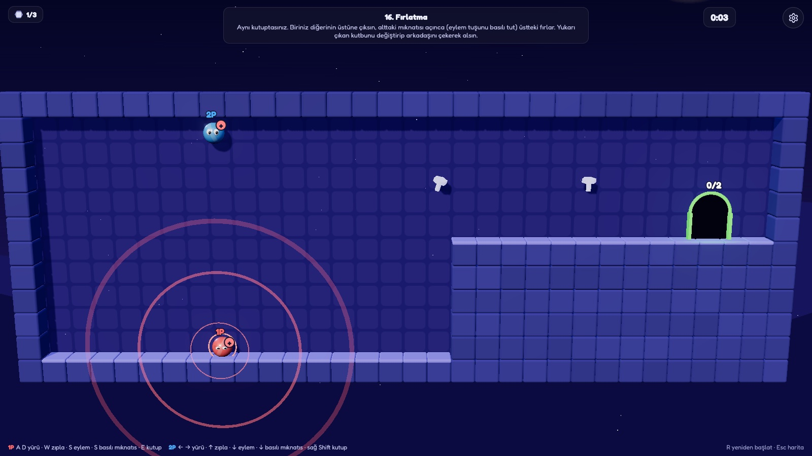
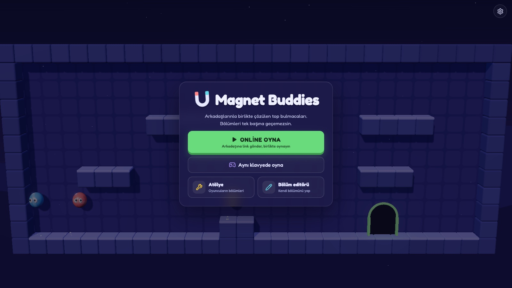
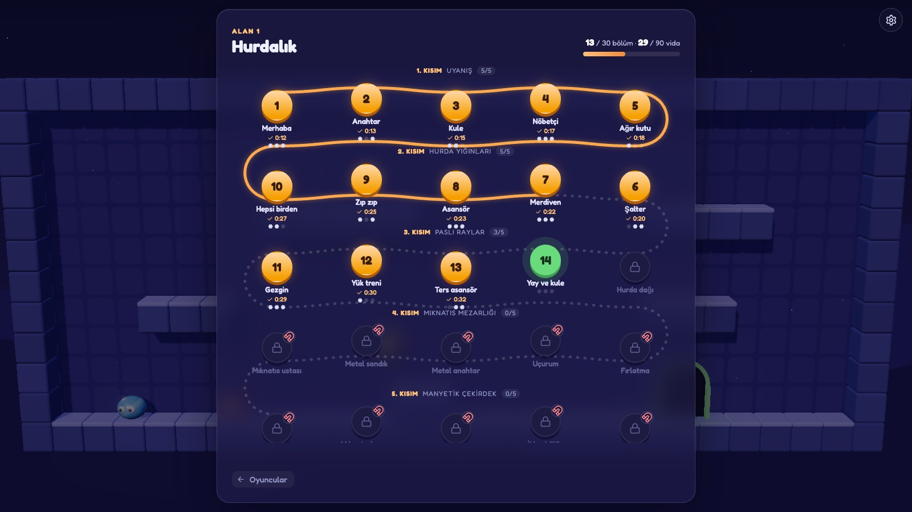
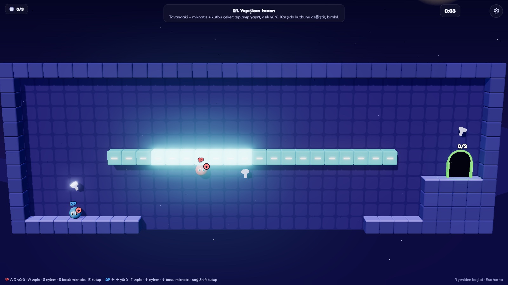
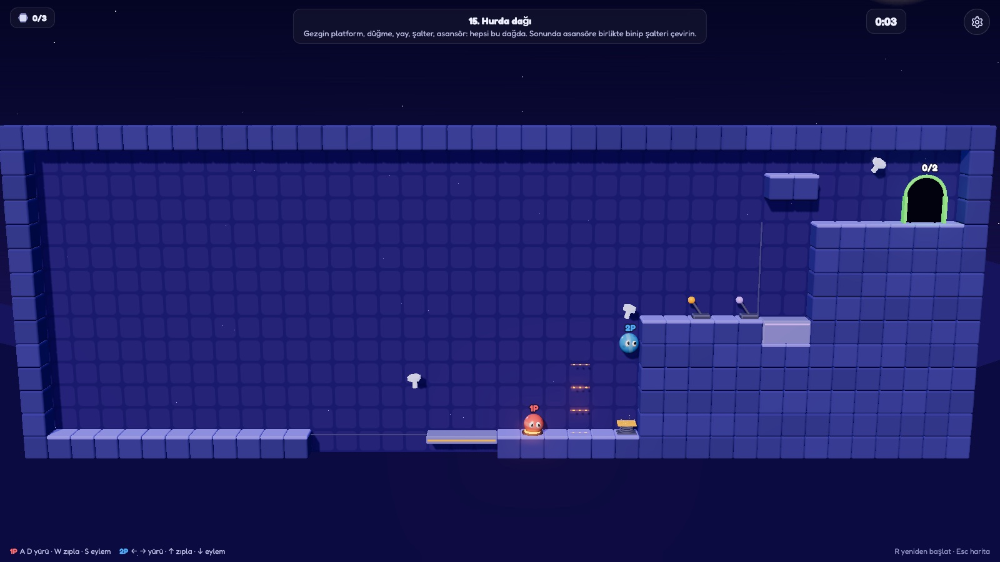
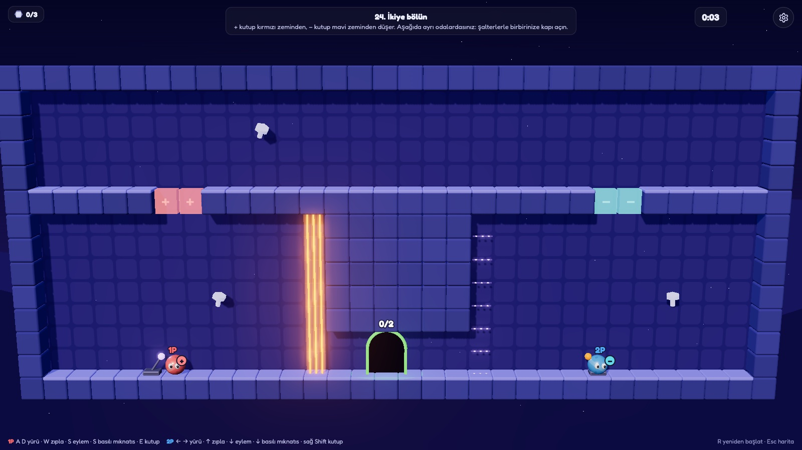
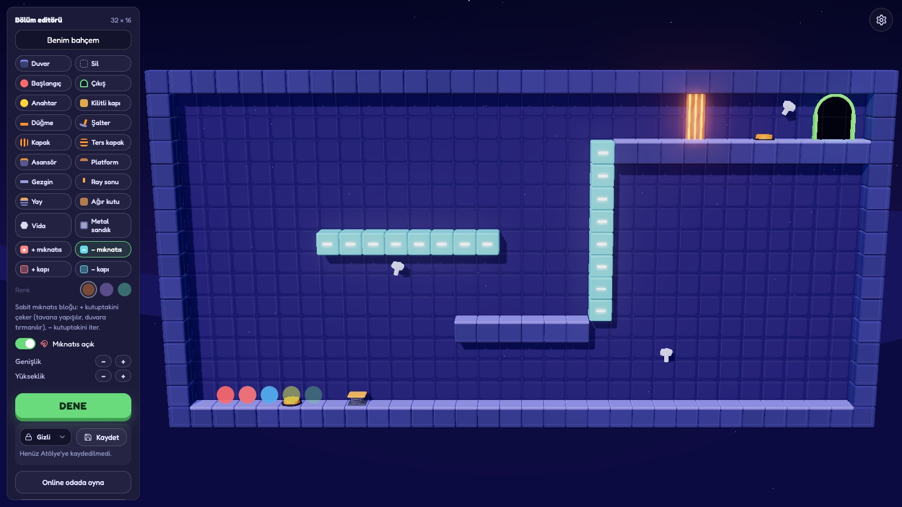
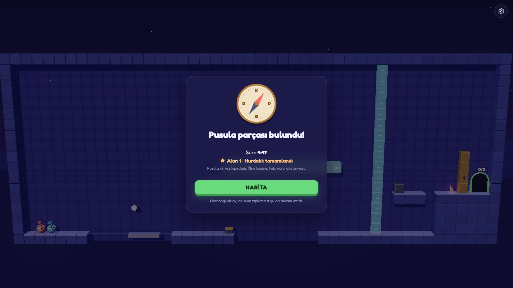

<div align="center">

# Magnet Buddies

**Arkadaşlarınla birlikte çözülen, mıknatıslı bir top bulmacası.**
Bölümleri tek başına geçemezsin.

[](https://magnet.bilen.dev)
&nbsp;

&nbsp;




</div>

## Oyun

Her oyuncu küçük, yuvarlak bir mıknatıstır. Birbirinizin üstüne çıkar, düğmelerde nöbet tutar,
anahtarı kapıya taşırsınız. Sonra mıknatıslar uyanır:

- **Aynı kutuptaki** arkadaşını havaya fırlatır ya da boşluğun karşısına itersin.
- **Zıt kutuptakini** yukarı ya da kendine çekersin.

Ölüm yok, acele yok. Çukura düşen, en son durduğu yerde doğar; bölüm, herkes kapıya girince biter.

**Nasıl oynanır:**
- Bir linkle **online** ya da **aynı klavyede** oynanır. Gamepad de takılabilir.
- 2 kişi yeter, 4 kişiye kadar oynanır.
- Her bölüm iki kişiyle çözülecek şekilde tasarlandı ve testlerle kanıtlandı.

<div align="center">

</div>

## Alan 1 · Hurdalık

Büyük Pusula bir fırtınada paramparça oldu ve iğnesinin parçaları dünyanın dört bir yanına savruldu.
İlk parça hurdalıkta. **6 kısımda 30 bölüm**, kıvrılan bir patikayla birbirine bağlı.

| Kısım | Bölümler | Yeni olan |
|---|---|---|
| 1 · Uyanış | 1–5 | Yürümek, zıplamak, kule kurmak, anahtar, düğme, ağır kutu |
| 2 · Hurda yığınları | 6–10 | Şalter, ince platform, asansör, yay |
| 3 · Paslı raylar | 11–15 | Gezgin platform, ters kapak |
| 4 · Mıknatıs mezarlığı | 16–20 | Fırlatma, uçurumu itip çekme, metal anahtar, metal sandık |
| 5 · Manyetik çekirdek | 21–25 | Tavana yapışma, mıknatıslı duvara tırmanma, kutup kapıları |
| 6 · Pusula parçası | 26–30 | Hepsi bir arada ve final |

<table>
<tr>
<td></td>
<td></td>
</tr>
<tr>
<td align="center"><b>Harita.</b> Geçtiğin bölümler, süren ve topladığın vidalar.</td>
<td align="center"><b>Yapışkan tavan.</b> Zıt kutupla yapış, asılı yürü, kutup değiştirip bırak.</td>
</tr>
<tr>
<td></td>
<td></td>
</tr>
<tr>
<td align="center"><b>Hurda dağı.</b> Biri kapağı tutar, öbürü yayla rafa uçar.</td>
<td align="center"><b>İkiye bölün.</b> + kırmızıdan, − maviden düşer; şalterlerle birbirinize kapı açın.</td>
</tr>
</table>

Her bölümde isteğe bağlı **3 vida** var; toplananlar haritada görünür. Son bölümde pusula parçasını
bulduğunuzda pusula ilk kez kıpırdar.

## Öğeler

| | |
|---|---|
| **Anahtar ve kilitli kapı** | Anahtarı kapıya taşı; atabilir, mıknatısla çekebilirsin |
| **Düğme ve kapak** | Düğme yalnızca üstünde biri dururken açar |
| **Şalter** | Bir kez çevrilince açık kalır |
| **Ters kapak** | Düğmeye basılınca kapanır |
| **Asansör** | Düğme ya da şalterle çıkar, üstündekileri taşır |
| **Gezgin platform** | İki uç arasında gidip gelir |
| **İnce platform** | Alttan geçilir, üstüne basılır |
| **Yay** | Fırlatır; zıplamayı basılı tutarsan daha yükseğe |
| **Ağır kutu** | İki kişi birlikte iter |
| **Metal sandık** | Tek kişi iter, mıknatıs çeker |
| **Sabit mıknatıs** | Zıt kutbu çeker: tavana yapışılır, duvara tırmanılır |
| **Kutup kapısı** | Yalnızca aynı kutuptaki oyuncu geçer |

## Kontroller

| | Yürü | Zıpla | Eylem (bırak/at, şalter; basılı: mıknatıs) | Kutup değiştir |
|---|---|---|---|---|
| 1. oyuncu | A D | W | S | E |
| 2. oyuncu | ← → | ↑ | ↓ | Sağ Shift |
| 3. oyuncu | J L | I | K | U |
| 4. oyuncu | Numpad 4 6 | Numpad 8 | Numpad 5 | Numpad 7 |
| Gamepad | Çubuk | A | B | X / Y |
| Telefon | Sol alttaki ‹ › | Sağdaki ↑ | Sağdaki el / mıknatıs | Sağdaki kutup tuşu |

Online oyunda herkes kendi bilgisayarında 1. ya da 2. oyuncunun tuşlarını kullanır.
**R** bölümü baştan başlatır, **Esc** haritaya döner (ikisi de sol üstteki menüde).
Telefonda yatay oynanır; online oyunda telefon ve bilgisayar aynı odada olabilir. iPhone'da tam ekran için Safari'den **Ana Ekrana Ekle**.

## Atölye ve bölüm editörü

Kendi bölümünü editörde çiz, hemen dene, linkle paylaş ya da online odada arkadaşlarınla oyna.
Google ile giriş yaparsan:

- Bölümlerini kaydedebilir ve her cihazdan açabilirsin.
- Atölye'de herkesle paylaşabilirsin.
- Başkalarının bölümlerini beğenebilirsin.
- Birkaç bölümü sırayla oynatan paketler kurabilirsin.

İlerlemen (süreler, vidalar) da hesabına kaydedilir.

<table>
<tr>
<td></td>
<td></td>
</tr>
<tr>
<td align="center"><b>Bölüm editörü.</b> Oyundaki her öğe editörde.</td>
<td align="center"><b>Alan 1'in sonu.</b> İğne kuzeyi gösteriyor…</td>
</tr>
</table>

## Kendi bilgisayarında çalıştırma

Node.js 18 ya da üstü gerekir.

```bash
npm install
npm start
```

Oyun `http://localhost:3000` adresinde açılır. Aynı ağdaki arkadaşların, oda linkiyle katılabilir.

Testler (fizik, otomatik botların 30 bölümü iki kişiyle bitirmesi, sunucu ve Atölye):

```bash
npm test
```

Oyun düz HTML, Canvas ve JavaScript ile yazıldı. Görüntü Three.js ile 2.5D çiziliyor (WebGL yoksa 2D);
ses ve müzik WebAudio ile anında üretiliyor. Online oyunda sunucu (Node.js ve WebSocket) aynı
simülasyonu çalıştırır.

## Sürümler

Her sürümde neyin değiştiği [CHANGELOG.md](CHANGELOG.md) ve [Releases](https://github.com/zafermesut/magnet-buddies/releases) sayfasında. Oyunda hangi sürümü oynadığın Ayarlar penceresinin altında yazar.

## Lisans

[MIT](LICENSE)
